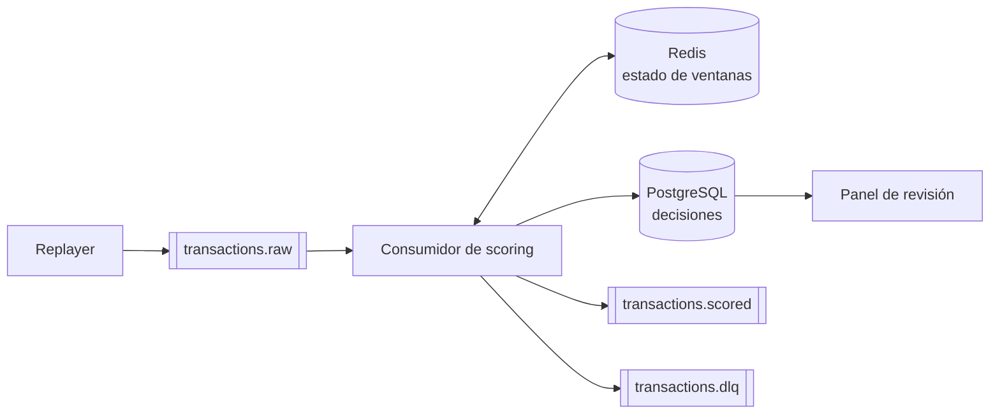

<p align="right">
  
  <a href="README.md"></a>
</p>

# Shield: detector de fraude en tiempo casi real

Shield puntúa cada transacción de pago en el momento en que ocurre y decide si se **aprueba**, se envía a **revisión**
o se **rechaza**. Cada decisión se guarda con sus tres razones principales, para que un analista de riesgo pueda
revisarla y justificarla.

El foco está en el pipeline: ingesta de baja latencia, garantías de calidad de datos y, sobre todo, **consistencia de
las features entre entrenamiento e inferencia**. Batch y streaming calculan las features con la misma librería, y una
prueba automática de paridad comprueba que ambos caminos coinciden.

> En desarrollo. La arquitectura está definida y el replayer de eventos está implementado; el resto de componentes se
> está construyendo.

## Cómo funciona



- **Replayer:** reproduce el dataset [Sparkov](https://www.kaggle.com/datasets/kartik2112/fraud-detection) en Kafka en
  orden de tiempo de evento, con aceleración configurable y el número de tarjeta como clave. La etiqueta de fraude nunca
  se publica.
- **Consumidor de scoring:** valida cada evento, calcula features en ventana (1 h, 24 h y 7 días por tarjeta y por
  comercio) con el estado en Redis, lo puntúa con el modelo activo y guarda la decisión. Los eventos inválidos van a la
  cola de errores.
- **Camino batch:** genera el dataset de entrenamiento a partir del histórico con la misma librería de features, usando
  solo etiquetas que ya estarían disponibles (unos 30 días después de la transacción), y reentrena el modelo de forma
  periódica.

| Objetivo | Valor |
|---|---|
| Latencia de scoring | p95 < 200 ms |
| Latencia extremo a extremo (evento publicado a decisión guardada) | p95 < 1 s |
| Throughput sostenido en local | ≥ 500 eventos/s |
| Paridad de features entre batch y streaming | 100 % sobre 1.000 transacciones |

## Stack

Apache Kafka (KRaft), Confluent Schema Registry (Avro), Redis, PostgreSQL, Python, FastAPI, Streamlit, Airflow,
Prometheus y Grafana. Docker Compose en local; AWS (MSK, MemoryDB, RDS, ECS Fargate) con Terraform.

## Estado

- [x] Arquitectura y registro de decisiones
- [x] Contrato del evento (`schemas/transaction.avsc`)
- [x] Replayer
- [ ] Entorno local (Docker Compose, topics, esquema de base de datos)
- [ ] Librería de features compartida y generador del dataset de entrenamiento
- [ ] Consumidor de scoring, cola de errores y API de scoring
- [ ] Panel de revisión
- [ ] Prueba de paridad entre batch y streaming en CI
- [ ] Métricas y paneles
- [ ] Orquestación del reentrenamiento y recarga del modelo sin reinicio

## Inicio rápido

Probado con Python 3.13. Descarga los CSV de Sparkov desde Kaggle en `data/raw/` (no se versionan).

```bash
pip install -r requirements.txt

# Validar e imprimir eventos sin Kafka
python src/replayer.py data/raw/fraudTest.csv --dry-run --limit 5

# Publicar en Kafka: 1 hora de datos por segundo (necesita Kafka, Schema Registry y el topic transactions.raw)
python src/replayer.py data/raw/fraudTest.csv --speedup 3600
```

La conexión se configura con variables de entorno; ver [`.env.example`](.env.example).

## Documentación

- [Arquitectura](docs/architecture.md): componentes, flujo de datos, manejo de fallos y despliegue
- [Replayer](docs/replayer.md): qué publica y cómo ejecutarlo
- [Registro de decisiones de arquitectura](docs/decisions/es/README.md)

## Estructura del repositorio

```
docs/       arquitectura, replayer y registro de decisiones
schemas/    contratos Avro de los eventos
src/        replayer (se irán añadiendo más componentes)
```

## Equipo

Desarrollado por Gabriel (ingeniería de datos: streaming y pipelines) y Alain (ciencia de datos: modelado).
