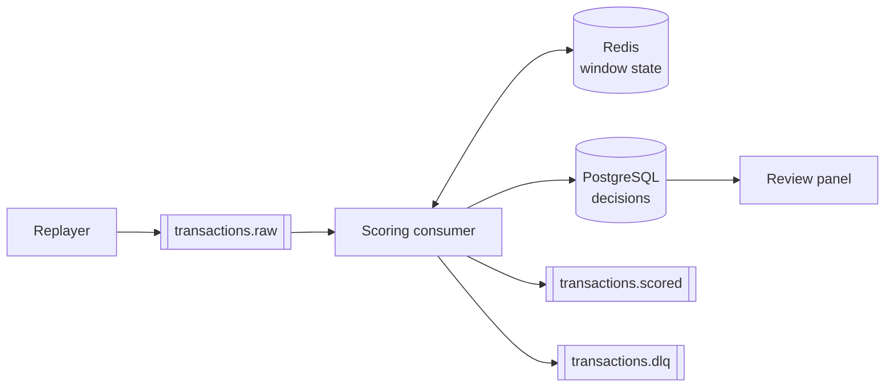

<p align="right">
  <a href="README.es.md"></a>
  
</p>

# Shield: Real-Time Fraud Detector

Shield scores every payment transaction as it happens and decides whether to **approve**, **review** or **reject** it.
Each decision is stored with its top three reasons, so a risk analyst can review and justify it.

The focus is on the pipeline: low-latency ingestion, strong data-quality guarantees and, above all, **feature
consistency between training and serving**. Batch and streaming compute features with the same library, and an
automated parity test checks that both paths agree.

> Work in progress. The architecture is defined and the event replayer is implemented; the rest of the components are
> being built.

## How it works



- **Replayer:** replays the [Sparkov](https://www.kaggle.com/datasets/kartik2112/fraud-detection) dataset into Kafka
  in event-time order, with configurable speed-up, keyed by card number. The fraud label is never published.
- **Scoring consumer:** validates each event, computes windowed features (1 h, 24 h, 7 d per card and merchant) with
  state in Redis, scores it with the active model and stores the decision. Invalid events go to a dead-letter queue.
- **Batch path:** builds the training dataset from history with the same feature library, using only labels that
  would already be available (about 30 days after the transaction), and retrains the model on a schedule.

| Target | Value |
|---|---|
| Scoring latency | p95 < 200 ms |
| End-to-end latency (event published to decision stored) | p95 < 1 s |
| Sustained throughput (local) | ≥ 500 events/s |
| Batch/streaming feature parity | 100 % on 1,000 transactions |

## Stack

Apache Kafka (KRaft), Confluent Schema Registry (Avro), Redis, PostgreSQL, Python, FastAPI, Streamlit, Airflow,
Prometheus and Grafana. Docker Compose locally; AWS (MSK, MemoryDB, RDS, ECS Fargate) via Terraform.

## Status

- [x] Architecture and decision records
- [x] Event contract (`schemas/transaction.avsc`)
- [x] Replayer
- [ ] Local environment (Docker Compose, topics, database schema)
- [ ] Shared feature library and training dataset generator
- [ ] Scoring consumer, dead-letter queue and scoring API
- [ ] Review panel
- [ ] Batch/streaming parity test in CI
- [ ] Metrics and dashboards
- [ ] Retraining orchestration and hot model reload

## Quick start

Tested with Python 3.13. Download the Sparkov CSVs from Kaggle into `data/raw/` (not versioned).

```bash
pip install -r requirements.txt

# Validate and print events without Kafka
python src/replayer.py data/raw/fraudTest.csv --dry-run --limit 5

# Publish to Kafka: 1 hour of data per second (needs Kafka, Schema Registry and the transactions.raw topic)
python src/replayer.py data/raw/fraudTest.csv --speedup 3600
```

Connection settings are read from environment variables; see [`.env.example`](.env.example).

## Documentation

The architecture and replayer documents are written in Spanish; decision records are available in both languages.

- [Architecture](docs/architecture.md): components, data flow, failure handling and deployment
- [Replayer](docs/replayer.md): what it publishes and how to run it
- [Architecture decision records](docs/decisions/en/README.md)

## Repository layout

```
docs/       architecture, replayer and decision records
schemas/    Avro event contracts
src/        replayer (more components to come)
```

## Team

Built by Gabriel (data engineering: streaming and pipelines) and Alain (data science: modeling).
