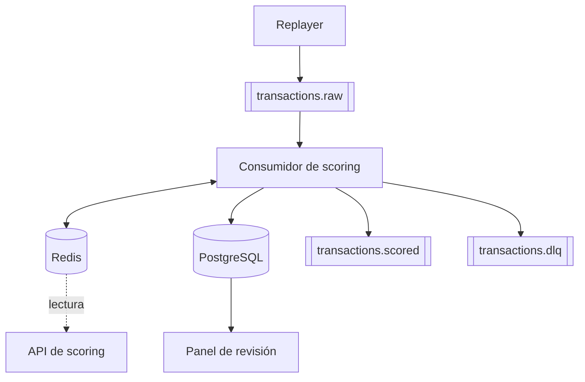
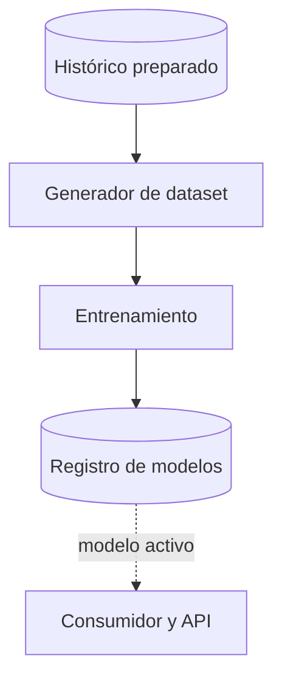
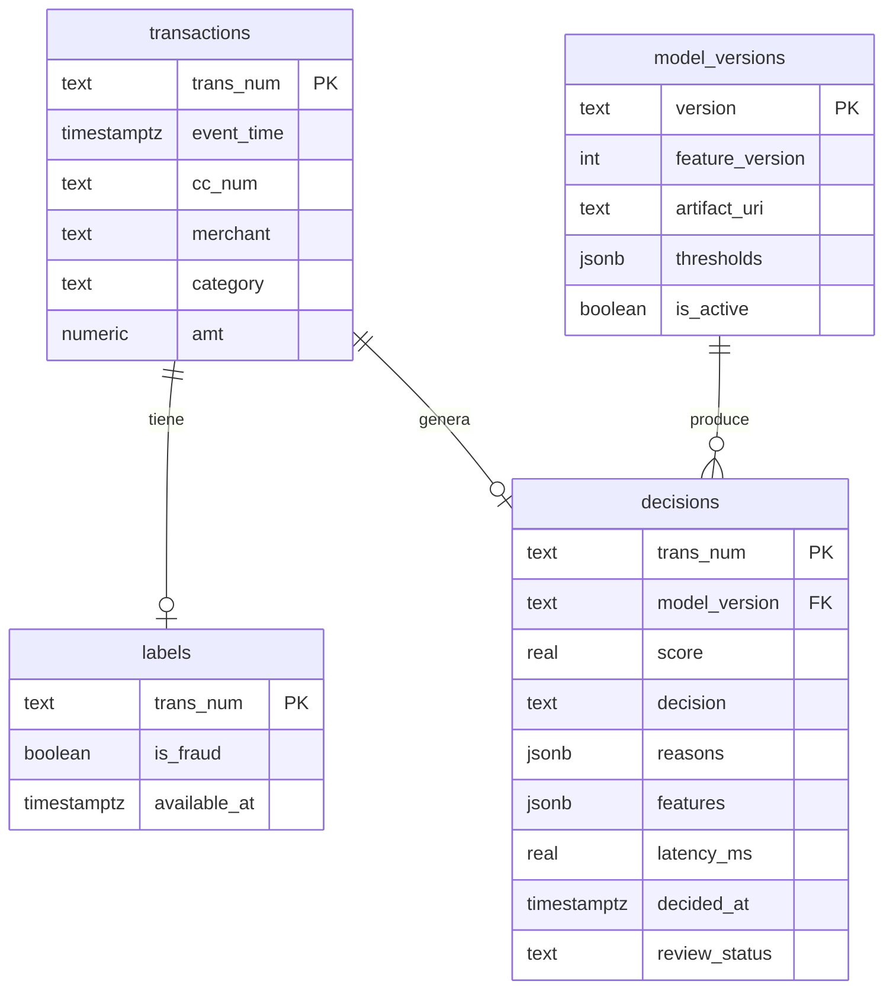

# Arquitectura

Shield puntúa cada transacción de pago en el momento en que ocurre y decide si se aprueba, se envía a revisión o se
rechaza. Cada decisión queda registrada con sus razones para que un analista de riesgo pueda revisarla y justificarla.

Este documento describe los componentes del sistema, cómo circulan los datos entre ellos y cómo se despliegan en local
y en AWS. Las decisiones que lo sustentan están en el [registro de decisiones de arquitectura](decisions/README.md).

## Requisitos

### Funcionales

- Puntuar cada transacción y asignarle una de tres decisiones: aprobar, revisar o rechazar.
- Explicar cada decisión con las tres razones que más pesaron en el score.
- Ofrecer al analista una cola de casos en revisión, ordenada por riesgo.
- Generar el dataset de entrenamiento y reentrenar el modelo de forma periódica.
- Publicar un modelo nuevo sin detener el servicio.

### No funcionales

| Requisito | Objetivo |
|---|---|
| Latencia de scoring | Percentil 95 por debajo de 200 ms |
| Latencia extremo a extremo (evento publicado → decisión persistida) | Percentil 95 por debajo de 1 s |
| Throughput sostenido en local | Al menos 500 eventos por segundo |
| Paridad de features entre batch y streaming | 100 % sobre una muestra de 1.000 transacciones |
| Trazabilidad | Cada decisión guarda score, razones, versión de modelo y features usadas |
| Pérdida de eventos | Ninguna: todo evento termina registrado como decisión o en la cola de errores |

## Principios

- **Una sola implementación de las features.** El entrenamiento y la inferencia calculan las features con la misma
  librería; solo cambia dónde se guarda el estado de las ventanas
  ([ADR-0006](decisions/es/0006-libreria-features-compartida.md)).
- **Tiempo de evento.** Las ventanas y las features se calculan con el momento en que ocurrió la transacción, nunca con
  el momento en que se procesa.
- **Orden por tarjeta.** Las transacciones de una misma tarjeta se procesan siempre en orden
  ([ADR-0004](decisions/es/0004-clave-particion-cc-num.md)).
- **Reprocesar es seguro.** Un evento puede procesarse más de una vez sin duplicar resultados
  ([ADR-0010](decisions/es/0010-at-least-once-idempotencia.md)).
- **Sin información del futuro.** La etiqueta de fraude no viaja en los eventos y solo se usa cuando ya estaría
  disponible en la realidad ([ADR-0011](decisions/es/0011-etiquetas-fuera-del-stream.md)).
- **Mismo código en local y en AWS.** Cada componente es un contenedor; entre entornos solo cambia la configuración
  ([ADR-0014](decisions/es/0014-despliegue-local-y-aws.md)).

## Vista general

El sistema tiene dos caminos que comparten la lógica de features: el camino streaming, que decide sobre cada
transacción en tiempo casi real, y el camino batch, que prepara los datos y entrena el modelo.

### Camino streaming



El replayer publica las transacciones en Kafka. El consumidor valida cada evento, calcula sus features con el estado
de las ventanas guardado en Redis, lo puntúa con el modelo activo y registra la decisión en PostgreSQL y en Kafka. Los
eventos inválidos van a la cola de errores. La API ofrece el mismo scoring bajo demanda.

### Camino batch



El generador recorre el histórico en orden temporal con la misma librería de features que usa el consumidor, solo con
etiquetas ya maduras. El modelo entrenado se registra como versión inactiva y, al promoverlo, el consumidor y la API lo
cargan sin reiniciarse.

## Componentes del camino streaming

### Replayer

Productor que reproduce el histórico de Sparkov como si fuera tráfico en vivo
([ADR-0001](decisions/es/0001-dataset-sparkov.md)). Su funcionamiento detallado está en [replayer.md](replayer.md).

| Aspecto | Comportamiento |
|---|---|
| Entrada | CSV de Sparkov, ordenados por tiempo de evento al cargarlos |
| Ritmo | Aceleración del tiempo configurable y tope opcional de eventos por segundo |
| Rango | Número máximo de eventos configurable |
| Tiempo de evento | Hora de Sparkov (local, sin zona) interpretada como UTC, igual que en el camino batch |
| Clave | Número de tarjeta |
| Etiqueta | No se publica |
| Marca de tiempo propia | Añade el momento de publicación para medir la latencia extremo a extremo |
| Entrega | Productor idempotente (confirmación de todas las réplicas) |
| Eventos inválidos | No se publican; se registran, se cuentan y el replayer continúa |
| Ejecución en AWS | Tarea de ECS Fargate bajo demanda ([ADR-0015](decisions/es/0015-ejecucion-replayer.md)) |

### Apache Kafka

Broker de eventos en modo KRaft, con Confluent Schema Registry como contrato de datos
([ADR-0002](decisions/es/0002-apache-kafka.md), [ADR-0003](decisions/es/0003-avro-schema-registry.md)). En local corre
un único nodo; en AWS, Amazon MSK con tres brokers en tres zonas de disponibilidad.

| Topic | Particiones | Retención | Clave | Contenido |
|---|---|---|---|---|
| `transactions.raw` | 6 | 8 días | Número de tarjeta | Transacción sin etiqueta |
| `transactions.scored` | 6 | 7 días | Número de tarjeta | Score, decisión, razones y versión de modelo |
| `transactions.dlq` | 1 | 30 días | — | Evento original y motivo del rechazo |

- Los topics se crean de forma explícita; el broker no los crea automáticamente.
- La retención del topic de entrada supera la ventana más larga (7 días) para poder reconstruir el estado de Redis.
  La retención se mide con el timestamp del mensaje, que es el momento de publicación, mientras que las ventanas se
  miden en tiempo de evento. Por eso el replayer no asigna `event_time` como timestamp del mensaje: con fechas de
  2019–2020, Kafka borraría los eventos nada más recibirlos.
- Los esquemas se validan con compatibilidad hacia atrás: los campos nuevos son opcionales y tienen valor por defecto.

Contrato del evento de entrada (`schemas/transaction.avsc`):

| Campo | Tipo | Descripción |
|---|---|---|
| `trans_num` | Texto | Identificador único de la transacción |
| `event_time` | Marca de tiempo (ms, UTC) | Momento en que ocurrió la transacción |
| `cc_num` | Texto | Número de tarjeta; clave de partición |
| `merchant` | Texto | Comercio |
| `category` | Texto | Categoría del comercio |
| `amt` | Decimal (12,2) | Importe |
| `lat`, `long` | Decimal de doble precisión | Ubicación del cliente |
| `merch_lat`, `merch_long` | Decimal de doble precisión | Ubicación del comercio |
| `city_pop` | Entero | Población de la ciudad del cliente |
| `dob` | Fecha | Fecha de nacimiento del cliente |
| `produced_at` | Marca de tiempo (ms, UTC) | Momento en que se publicó el evento |

Los identificadores directos del dataset original (nombre, apellidos, género, dirección, ciudad, estado, código postal y
profesión) no forman parte del evento. El número de tarjeta, la fecha de nacimiento y la ubicación del cliente sí
viajan porque las features los necesitan; se tratan como datos sensibles (ver [Seguridad y datos](#seguridad-y-datos)).

### Consumidor de scoring

Consumidor en Python que procesa los eventos por lotes ([ADR-0005](decisions/es/0005-consumidor-python.md)). Para cada
evento:

1. Valida el esquema y las reglas de negocio. Si falla, lo envía a la cola de errores con el motivo.
2. Descarta el evento si ya fue procesado (marca de procesado presente en Redis).
3. Lee el estado de la tarjeta y del comercio y calcula las features.
4. Puntúa con el modelo cargado en memoria y obtiene las tres razones principales
   ([ADR-0009](decisions/es/0009-modelo-embebido-consumidor.md)).
5. Asigna la decisión según los umbrales del modelo activo.
6. Registra la decisión en PostgreSQL con una inserción idempotente (si el identificador ya existe, no se modifica) y
   la publica en `transactions.scored`.
7. Actualiza el estado de las ventanas y guarda la marca de procesado en una única operación atómica.
8. Confirma su posición en Kafka.

El orden garantiza que reprocesar no pierde ni duplica nada:

- Si el consumidor falla antes del paso 7, el estado aún no incluye el evento: al reprocesarlo se obtienen las mismas
  features y el mismo score, la inserción en PostgreSQL no tiene efecto y el estado se actualiza una sola vez.
- Si falla después del paso 7, el evento se descarta en el paso 2 porque su decisión ya está registrada.
- Un reproceso puede publicar dos veces la misma decisión en `transactions.scored`; quien lo consuma debe descartar
  duplicados por identificador de transacción.

Dentro de un lote, las lecturas de Redis se agrupan, pero los eventos de una misma tarjeta o comercio se procesan en
orden sobre una copia local del estado, de modo que cada evento ve a los anteriores del mismo lote.

### Librería de features

Contiene toda la lógica de features, sin acceso directo a datos externos. El estado de las ventanas se obtiene a través
de una interfaz común con dos implementaciones: en memoria, para el generador de dataset, y en Redis, para el
consumidor.

| Feature | Definición |
|---|---|
| Transacciones de la tarjeta en 1 h, 24 h y 7 días | Número de transacciones previas en cada ventana |
| Importe de la tarjeta en 1 h, 24 h y 7 días | Suma de importes previos en cada ventana |
| Transacciones del comercio en 1 h y 24 h | Número de transacciones previas del comercio |
| Desviación del importe | Distancia del importe a la media de la tarjeta en los últimos 7 días, en desviaciones estándar |
| Distancia cliente-comercio | Distancia geográfica en kilómetros |
| Tiempo desde la transacción anterior | Segundos desde la compra previa de la tarjeta, dentro de los últimos 7 días |
| Velocidad implícita | Distancia entre comercios consecutivos dividida por el tiempo transcurrido |
| Hora y día de la semana | Derivados del tiempo de evento |
| Edad del cliente | Edad en la fecha de la transacción |

Reglas comunes a ambos caminos:

- Las ventanas incluyen solo transacciones anteriores: una transacción no se cuenta a sí misma.
- Ninguna feature mira más allá de 7 días, para que todo el estado pueda reconstruirse desde el topic de entrada.
- Si la tarjeta no tiene transacciones en los últimos 7 días, los contadores valen cero y el tiempo desde la anterior,
  la velocidad implícita y la desviación del importe quedan vacíos.
- Las transacciones con la misma marca de tiempo se ordenan por su identificador.
- Los importes se manejan como decimales exactos y solo se convierten a coma flotante al entrar al modelo.
- La versión del esquema de features se guarda con el dataset y con el modelo; el consumidor no arranca si no
  coinciden.

### Redis

Almacén del estado de las ventanas ([ADR-0007](decisions/es/0007-redis-estado-ventanas.md)). En AWS se usa Amazon
MemoryDB for Redis.

| Estado | Contenido | Vigencia |
|---|---|---|
| Ventana de la tarjeta | Transacciones de los últimos 7 días (importe y ubicación del comercio), ordenadas por tiempo de evento. De ella salen contadores, sumas, media, varianza y la transacción anterior | 7 días |
| Ventana del comercio | Transacciones de las últimas 24 horas | 24 horas |
| Transacciones procesadas | Marcas de procesado para descartar duplicados | 8 días |
| Modelo activo | Versión del modelo en uso | — |

Cada evento actualiza su estado y su marca de procesado en una única operación atómica. Las lecturas de un lote se
agrupan para reducir las llamadas de red.

La vigencia de las ventanas se mide en tiempo de evento: al procesar un evento se recortan las entradas anteriores a su
`event_time` menos la ventana. La caducidad de Redis solo sirve de limpieza, porque en una reproducción acelerada el
reloj real y el tiempo de evento avanzan a ritmos distintos.

### PostgreSQL

Guarda el histórico, las etiquetas, las decisiones y el registro de modelos
([ADR-0008](decisions/es/0008-postgresql-historico-decisiones.md)). En AWS se usa Amazon RDS for PostgreSQL.



| Tabla | Propósito |
|---|---|
| `transactions` | Histórico completo de transacciones, sin etiqueta |
| `labels` | Etiqueta de fraude y fecha en que estaría disponible en la realidad (30 días después de la transacción) |
| `decisions` | Score, decisión, razones, features usadas, versión de modelo, latencia, momento de la decisión y estado de revisión |
| `model_versions` | Versiones de modelo, umbrales, métricas, ubicación del artefacto y versión activa |

La cola del panel se apoya en un índice limitado a los casos en revisión pendientes, para no recorrer toda la tabla de
decisiones.

### API de scoring

Servicio FastAPI que puntúa transacciones bajo demanda con el mismo código de scoring que el consumidor. Lee el estado
de las ventanas en Redis pero no lo modifica: el consumidor es el único que escribe, porque es quien garantiza el orden
de los eventos.

| Operación | Descripción |
|---|---|
| Puntuar una transacción | Devuelve score, decisión, razones, versión de modelo y latencia |
| Consultar el modelo activo | Devuelve la versión en uso |
| Estado del servicio | Comprobación de salud |
| Métricas | Exposición de métricas operativas |

### Panel de revisión

Aplicación Streamlit sobre la tabla de decisiones. Muestra los casos en revisión ordenados por score, con las tres
razones de cada alerta y la actividad reciente de la tarjeta. El analista marca cada caso como confirmado o descartado.

## Componentes del camino batch

### Carga del histórico

Carga los CSV de Sparkov en PostgreSQL: las transacciones sin datos personales en `transactions` y las etiquetas en
`labels`, con su fecha de disponibilidad (30 días después de la transacción). En AWS se guardan también en S3, donde el
Glue Data Catalog las registra como tablas para consultarlas con Athena.

### Generación del dataset de entrenamiento

Recorre el histórico en orden temporal con la librería de features y su estado en memoria. Solo incluye etiquetas
disponibles en la fecha de corte, y entrega el dataset junto con la división temporal entre entrenamiento y validación
acordada con ciencia de datos.

### Entrenamiento y promoción

El entrenamiento usa el código del equipo de ciencia de datos y registra el modelo como versión inactiva, con sus
métricas y umbrales. La promoción comprueba esas métricas y la paridad de features, y marca la versión como activa.

### Orquestación

Airflow coordina los procesos batch ([ADR-0012](decisions/es/0012-airflow-orquestacion-batch.md)). Solo da las
órdenes: el procesamiento se ejecuta en contenedores, que en AWS son tareas de ECS Fargate.

| Flujo | Frecuencia | Pasos |
|---|---|---|
| Carga del histórico | Manual | Preparación de datos, carga en PostgreSQL y en S3, registro en el catálogo |
| Dataset de entrenamiento | Semanal | Generación del dataset con etiquetas maduras |
| Reentrenamiento | Semanal, después del anterior | Entrenamiento y registro de la nueva versión |
| Promoción | Manual | Validación de métricas y paridad, y activación de la versión |

## Contrato con ciencia de datos

| Dirección | Artefacto | Contenido |
|---|---|---|
| Ingeniería → Ciencia de datos | Dataset de entrenamiento | Features generadas con la librería de producción, etiquetas maduras y versión del esquema de features |
| Ingeniería → Ciencia de datos | Diccionario de features | Nombre, tipo, ventana y definición de cada feature |
| Ciencia de datos → Ingeniería | Modelo | Artefacto serializado y lista ordenada de las features que espera |
| Ciencia de datos → Ingeniería | Umbrales | Límites entre aprobar, revisar y rechazar |
| Ciencia de datos → Ingeniería | Explicador | Las tres features con mayor contribución al score, con su valor y su peso |

Cualquier feature nueva se incorpora a la librería compartida, de modo que esté disponible en ambos caminos.

## Consistencia entre batch y streaming

Una prueba automática verifica en integración continua que ambos caminos producen el mismo resultado:

1. Se seleccionan 1.000 transacciones de un rango fijo, junto con los 7 días previos para llenar las ventanas.
2. Se calculan features y scores con el generador de dataset.
3. Se levantan Kafka, Schema Registry y Redis, se reproducen las mismas transacciones y se leen las decisiones.
4. Se comparan por transacción: features y scores deben coincidir dentro de una tolerancia numérica mínima, y las
   decisiones deben ser idénticas.

## Calidad de datos

| Punto de control | Validación | Si falla |
|---|---|---|
| Preparación de datos | Campos obligatorios, importes positivos, coordenadas en rango, identificadores únicos | La fila se guarda aparte con su motivo |
| Publicación | El evento debe cumplir el esquema registrado | El evento no se publica; el replayer lo registra y continúa |
| Consumo | Las mismas reglas que en la preparación, más una fecha de evento no futura | El evento va a la cola de errores con su motivo |
| Duplicados | Identificador de transacción ya procesado | El evento se descarta y se contabiliza |
| Reconciliación | Eventos de entrada = decisiones + eventos en la cola de errores, por hora | Se genera una alerta |

## Fiabilidad

| Fallo | Impacto | Recuperación |
|---|---|---|
| Caída del consumidor | Aumenta el retraso del consumo | Reanuda desde la última posición confirmada |
| Caída de PostgreSQL | No se pueden registrar decisiones | El consumidor se detiene y reintenta, sin confirmar posiciones ni perder eventos |
| Pérdida del estado de Redis | Features incorrectas | Se reconstruye releyendo los últimos 7 días del topic de entrada antes de reanudar |
| Modelo defectuoso | Decisiones incorrectas | Se reactiva la versión anterior |
| Pico de tráfico | Aumenta la latencia | Se escalan consumidores hasta el número de particiones |
| Evento mal formado | — | Va a la cola de errores sin bloquear la partición |

El punto más crítico es el estado de Redis: si se pierde, el sistema sigue respondiendo pero con features incorrectas.
Por eso, en local Redis persiste en disco, en AWS MemoryDB replica entre zonas, y el topic de entrada conserva
siempre la ventana completa.

## Observabilidad

Propuesta pendiente de aprobación ([ADR-0013](decisions/es/0013-observabilidad.md)). Los servicios exponen sus
métricas en formato Prometheus. En local, Prometheus y Grafana las recogen y las muestran; en AWS lo hace CloudWatch,
junto con las métricas propias de MSK, RDS y MemoryDB.

| Métrica | Uso |
|---|---|
| Latencia de scoring (percentiles 50, 95 y 99) | Verificar el objetivo de 200 ms |
| Latencia extremo a extremo | Tiempo entre la publicación del evento y el registro de la decisión |
| Eventos procesados por decisión | Distribución entre aprobar, revisar y rechazar |
| Eventos en la cola de errores por motivo | Calidad de los datos de entrada |
| Duplicados descartados | Frecuencia de reprocesamiento |
| Retraso del grupo de consumo | Capacidad del consumidor frente al tráfico |
| Versión de modelo activa | Trazabilidad de los despliegues |

## Seguridad y datos

- Los identificadores directos del dataset (nombre, dirección, profesión…) no se publican en Kafka ni se guardan en
  PostgreSQL.
- El número de tarjeta, la fecha de nacimiento y la ubicación del cliente se consideran sensibles: el acceso a los
  topics, a Redis y a PostgreSQL se limita a los servicios que los necesitan, y en AWS se cifran en tránsito y en
  reposo.
- En AWS, todos los componentes se ejecutan en una red privada; solo el panel y la API se exponen.
- Las credenciales se obtienen de AWS Secrets Manager; en local, de variables de entorno.
- Cada servicio tiene su propio rol con los permisos mínimos necesarios.

## Despliegue

### Local

Docker Compose levanta el sistema completo ([ADR-0014](decisions/es/0014-despliegue-local-y-aws.md)).

| Servicio | Función |
|---|---|
| Kafka (KRaft) | Broker de eventos |
| Schema Registry | Contrato de datos |
| Kafka UI | Inspección de topics y grupos de consumo |
| Redis | Estado de las ventanas |
| PostgreSQL | Histórico, decisiones y registro de modelos |
| Replayer | Fuente de eventos |
| Consumidor de scoring | Procesamiento en streaming |
| API de scoring | Scoring bajo demanda |
| Panel de revisión | Cola de casos para el analista |
| Prometheus y Grafana | Métricas y paneles |
| Airflow | Orquestación batch, en un perfil aparte por su consumo de recursos |

### AWS

| Componente | Servicio | Decisión |
|---|---|---|
| Kafka | Amazon MSK | [ADR-0002](decisions/es/0002-apache-kafka.md) |
| Schema Registry | Confluent Schema Registry en ECS Fargate | [ADR-0003](decisions/es/0003-avro-schema-registry.md) |
| Estado de las ventanas | Amazon MemoryDB for Redis | [ADR-0007](decisions/es/0007-redis-estado-ventanas.md) |
| Histórico, decisiones y registro de modelos | Amazon RDS for PostgreSQL | [ADR-0008](decisions/es/0008-postgresql-historico-decisiones.md) |
| Histórico analítico y artefactos de modelo | Amazon S3, Glue Data Catalog y Athena | [ADR-0008](decisions/es/0008-postgresql-historico-decisiones.md) |
| Replayer | Tarea de ECS Fargate bajo demanda | [ADR-0015](decisions/es/0015-ejecucion-replayer.md) |
| Consumidor, API y panel | Servicios de ECS Fargate | [ADR-0014](decisions/es/0014-despliegue-local-y-aws.md) |
| Orquestación | Amazon MWAA, con el procesamiento en tareas de ECS Fargate | [ADR-0012](decisions/es/0012-airflow-orquestacion-batch.md) |
| Métricas | Amazon CloudWatch | [ADR-0013](decisions/es/0013-observabilidad.md) |
| Credenciales | AWS Secrets Manager | [ADR-0014](decisions/es/0014-despliegue-local-y-aws.md) |
| Infraestructura | Terraform | [ADR-0014](decisions/es/0014-despliegue-local-y-aws.md) |

El entorno de AWS se crea y se destruye bajo demanda para controlar el coste.

## Estructura del repositorio

```
.
├── docs/
│   ├── architecture.md
│   ├── replayer.md
│   └── decisions/         registro de decisiones (es/ y en/)
├── schemas/               contratos Avro de los eventos
├── scripts/               descarga del dataset (pendiente)
├── src/
│   ├── replayer.py        replayer
│   ├── shield_features/   librería de features
│   ├── shield_scoring/    carga del modelo, umbrales y explicador
│   ├── consumer/          consumidor de scoring
│   ├── api/               API de scoring
│   └── panel/             panel de revisión
├── dags/                  flujos de Airflow
├── sql/                   esquema y migraciones de PostgreSQL
├── infra/                 Kafka, Prometheus, Grafana y Terraform
├── tests/                 pruebas unitarias, de integración y de paridad
└── docker-compose.yml
```

Hoy existen la documentación, los esquemas, el replayer y sus pruebas. El resto de componentes
se incorporará a medida que se implementen.
